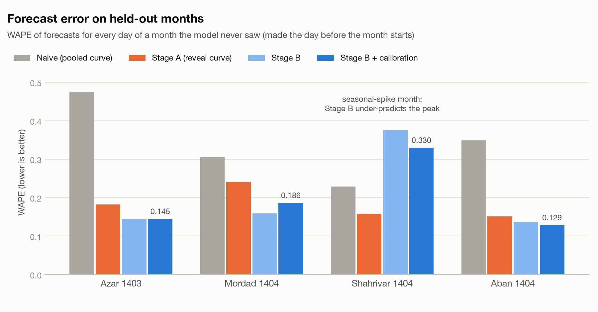
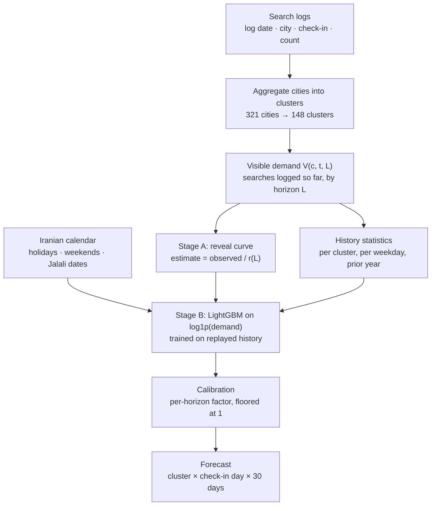
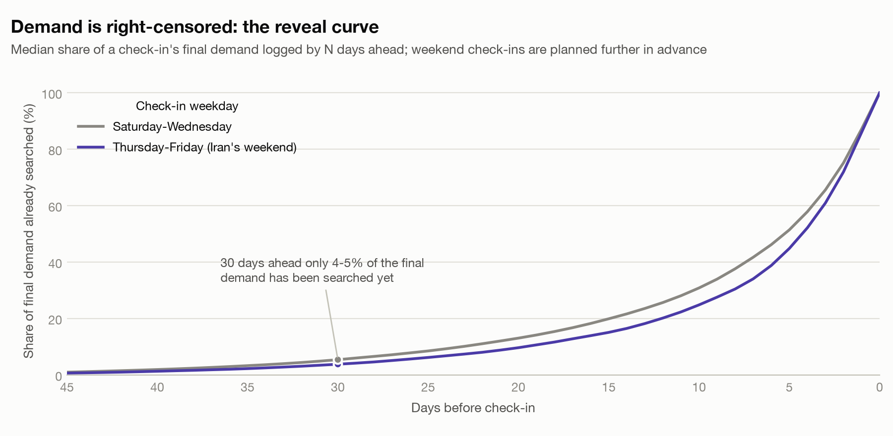
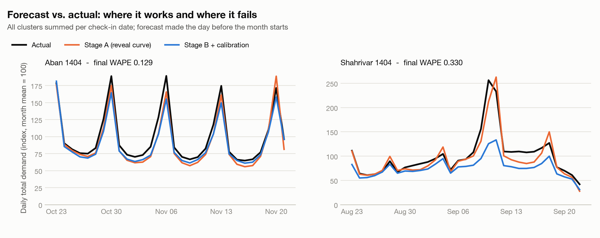
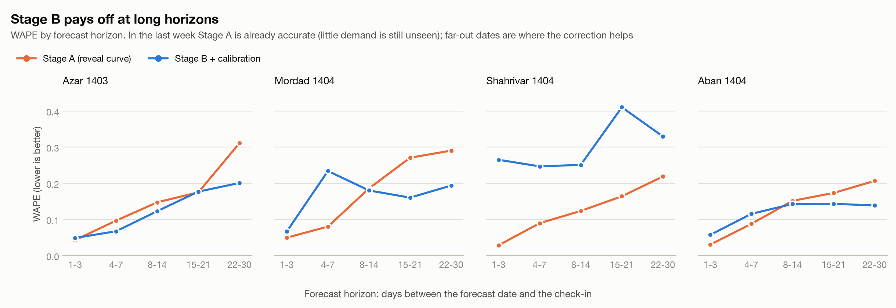

# Search-Demand Forecasting under Right-Censoring

**Forecast next month's demand for every city and every day from *partially observed* search logs** -
a two-stage *reveal-curve + LightGBM* model with leakage-free backtesting.
Originally a hackathon assignment on short-term-rental search data.




|  |  |
|---|---|
| **Task** | On the last day of a month, forecast the final search demand of **148 city clusters × 30 check-in days** (4,440 numbers), scored with WAPE |
| **Key idea** | Demand for a future date is *right-censored* - only a few percent of it has been searched yet. A learned **reveal curve** grosses up what is visible; a **LightGBM model trained on replayed history** corrects the remaining bias |
| **Result** | On three of four held-out months WAPE falls from **0.30-0.47** (naive scaling) to **0.13-0.19**; on one seasonal-spike month the correction *hurts*, and this README digs into why |
| **Engineering** | Installable package + CLI · 64 tests (incl. a leakage test) · GitHub Actions CI (3.10-3.12) · no pickle · runs end to end on synthetic data · reproduces the original solution's outputs **exactly** |

---

## Contents

1. [The problem](#1-the-problem)
2. [Approach](#2-approach)
3. [Results](#3-results)
4. [Failure analysis and mitigations](#4-failure-analysis-and-mitigations)
5. [What I tried (and what did not work)](#5-what-i-tried-and-what-did-not-work)
6. [Limitations](#6-limitations)
7. [Repository structure](#7-repository-structure)
8. [Quick start](#8-quick-start)
9. [CLI and Python API](#9-cli-and-python-api)
10. [Engineering and reproducibility](#10-engineering-and-reproducibility)
11. [Data availability](#11-data-availability)
12. [Roadmap](#12-roadmap)
13. [What this project demonstrates](#13-what-this-project-demonstrates)

---

## 1. The problem

A rental platform logs every search as *(log date, city, intended check-in date)*. For a
(city, check-in) pair, **demand** is the total number of searches ever made for it. On the last
day of a month the platform wants the demand of **every city for every check-in day of the next
month** - the kind of forecast that guides supply acquisition, pricing and marketing.

* **Metric:** WAPE = Σ|forecast − actual| / Σ actual - demand-weighted, so large cities dominate.
* **Freedom:** cities may be grouped into clusters, but "excessive aggregation is penalised" - so
  grouping should be as small as possible.
* **Data:** ~3.3 M aggregated log rows, 321 cities, 2023-11 → 2025-11, plus the logs of the
  target month *up to the forecast origin*.

**Why it is hard**

| | |
|---|---|
| **Right-censoring** | A date 30 days out has only ~4-5 % of its eventual searches in the log. The best predictor is partial by construction, and *how* partial depends on horizon, weekday and city. |
| **Heavy tails** | The 20 largest of 148 clusters carry ~80 % of the volume; hundreds of small cities are mostly zeros. |
| **Little history** | ~2 years: Nowruz and the Shahrivar travel peak have one or two prior occurrences. |
| **Another calendar** | Demand follows the Persian calendar (Nowruz, Yalda, Jalali months) and a **Thursday-Friday weekend**. |

## 2. Approach



**Stage A - a physical model of censoring.** If, historically, a fraction `r(L)` of a check-in's
demand has been searched `L` days ahead, then `demand ≈ observed / r(L)`. `r` is the median of
that fraction per cluster, times a pooled weekday factor - *weekend check-ins are planned further
ahead*, so a fixed horizon reveals less of them.



**Stage B - a statistical correction.** A LightGBM regressor on `log1p(demand)` (L1 loss) learns
when and by how much Stage A is biased, from 20 features: the censored signal, Persian-calendar
and holiday-*block* features, per-cluster and per-weekday history, and last year's demand. Its
training set **replays history**: every past (cluster, check-in) is re-observed at 13 simulated
horizons, so the model learns in exactly the partial-information regime it will face (~1.45 M rows).

**Calibration.** An L1 loss predicts the conditional *median*, below the *mean* that WAPE rewards.
A per-horizon multiplicative factor, estimated on a held-out time fold and **floored at 1**
(median ≤ mean, so a factor below 1 can only be noise), corrects this.

**Clustering.** Sparse cities are merged into their nearest same-province neighbour until every
cluster clears 500 searches in *every* month of the reference year: 321 cities → 148 clusters
(80 stay alone).

**Leakage control.** Every fitted quantity uses check-ins strictly *before* the scored window. A
test inflates all demand logged after the cutoff and asserts that no feature, no Stage A estimate
and no training row changes.

> Full write-up with notation, design rationale and caveats: **[docs/METHODOLOGY.md](docs/METHODOLOGY.md)**

## 3. Results

Rolling-origin backtests: to score a month the model pretends it is the day before it starts,
trains only on earlier check-ins, and forecasts all 30 days. Four months can be scored (the logs
end before the real target month resolves, so the target itself has **no ground truth**).

| Held-out month | Naive | Stage A | Stage B | **Stage B + calibration** (shipped) |
|---|---:|---:|---:|---:|
| Azar 1403 | 0.474 | 0.182 | 0.145 | **0.145** |
| Mordad 1404 | 0.305 | 0.241 | 0.159 | **0.186** |
| Shahrivar 1404 *(seasonal spike)* | 0.229 | 0.159 | 0.375 | **0.330** |
| Aban 1404 | 0.349 | 0.152 | 0.137 | **0.129** |
| *mean, 3 regular months* | *0.376* | *0.192* | *0.147* | ***0.153*** |
| *mean, all 4 months* | *0.339* | *0.183* | *0.204* | ***0.197*** |

*WAPE, lower is better; "Naive" scales the visible demand with one pooled reveal curve; shipped =
the final configuration of the original solution. These are single-seed numbers of the
exact shipped pipeline; the seed-to-seed spread is shown below.*

**Reading the table**

* **On regular months the full model removes ~60 % of the naive error and ~20 % of Stage A's**
  (0.376 → 0.153 and 0.192 → 0.153).
* **Seasonal-spike month (Shahrivar): Stage B makes things worse than not correcting at all**
  (0.375 vs Stage A's 0.159). See [section 4](#4-failure-analysis-and-mitigations).
* **Calibration is a mixed blessing:** it helps Aban (−0.008) and Shahrivar (−0.046), is neutral on
  Azar, and *hurts* Mordad (+0.027). It corrects a bias learned from the last 60 days, so it
  inherits that period's quirks.



### How much of this is noise?

Re-training with four different LightGBM seeds (mean ± standard deviation):

| Month | Stage A | Stage B | Stage B + calibration | + guardrail ([§4](#4-failure-analysis-and-mitigations)) |
|---|---:|---:|---:|---:|
| Azar 1403 | 0.182 | 0.139 ± 0.005 | 0.139 ± 0.005 | 0.142 ± 0.006 |
| Mordad 1404 | 0.241 | 0.161 ± 0.001 | 0.186 ± 0.006 | 0.185 ± 0.005 |
| Shahrivar 1404 | 0.159 | 0.426 ± 0.034 | 0.365 ± 0.024 | **0.260 ± 0.010** |
| Aban 1404 | 0.152 | 0.135 ± 0.002 | 0.124 ± 0.003 | 0.125 ± 0.003 |

The qualitative conclusions hold for every seed (Stage B beats Stage A on regular months;
calibration helps Aban and hurts Mordad; Shahrivar fails). But **differences below ~0.01 WAPE on a
regular month - and below ~0.05 on the spike month - are not distinguishable from noise**, which
matters for reading the experiment log below.

### Where does the error live?



* **Stage B pays off beyond ~8 days ahead** (pooled over the three regular months: 22-30 days
  0.267 → 0.177, 15-21 days 0.209 → 0.160) **but is worse than Stage A in the last week** (1-7 days:
  0.04-0.09 vs 0.06-0.14), where little demand is still unseen and the reveal curve is already exact.
* **Concentration:** the 20 largest of 148 clusters hold ~80 % of demand and 68-77 % of the error.
  Cells with demand under 10 are 2.5 % of cells but 0.006 % of demand.

## 4. Failure analysis and mitigations

**The failure.** In Shahrivar 1404 (the end-of-summer travel peak, ~2× a normal month) Stage A
alone is *at its best* (0.159) but Stage B degrades to 0.375: on the peak days its forecasts fall
far below both the actual demand and Stage A's - see the right panel above.

**Hypothesis** (supported by the experiments, not proven): the shared model sees only one or two
prior occurrences of such extreme days, and the unweighted log-scale L1 loss is not aligned with a
demand-weighted metric, so the model regresses extreme cells toward a typical level.

| Mitigation | Effect on the spike month | Cost elsewhere | Verdict |
|---|---|---|---|
| Demand-weighted training (raw / √) | 0.43 → 0.21 / 0.47 → 0.22 *(earlier cluster scheme)* | +0.005 to +0.02 on the other months; raw weighting once failed to converge | not adopted (`--sample-weighting sqrt` available) |
| Quantile / Huber objectives | no consistent gain (Huber 0.60) | - | rejected |
| Per-cluster features, target encoding, Bayesian shrinkage | none or worse | - | rejected: the cluster "noise" *is* seasonality |
| **Guardrail**: clip Stage B to 0.7-1.5 × Stage A on large cells | **0.365 → 0.260** (4 seeds) | negligible: +0.001 on the regular-month mean | ✅ **recommended** (`demand-forecast forecast --guardrail`) |
| Route horizons ≤ 7 days to Stage A *(post-hoc)* | 0.330 → 0.297 | improves regular months too (0.153 → 0.147) | promising, needs validation |

Guardrail + routing together gave a 4-month mean of 0.167 (vs 0.197 shipped) - but those
thresholds were chosen *after* looking at these same four windows, so treat them as leads, not
results. The shipped configuration keeps the guardrail **off** to stay identical to the original
solution.

## 5. What I tried (and what did not work)

Over 35 experiments were logged during development, plus follow-ups made for this repository;
negative results are kept on purpose ([full log](docs/EXPERIMENTS.md)). Highlights:

| Idea | Outcome |
|---|---|
| Week-of-Jalali-year, month/weekday/week-of-month features | ✅ the largest single gains (e.g. 0.160 → 0.134) |
| Thursday-Friday weekend and Saturday-first weekday order | ✅ a correctness fix the data demanded |
| Per-cluster × weekday history (a *level* effect, not a timing one) | ✅ small gain |
| Raw `cluster_code` / shrunk residual-bias as features | ❌ overfit or no gain |
| Hierarchical-Bayes shrinkage of cluster history | ❌ high-variance resorts have *real* seasonality; shrinkage erased the signal |
| CatBoost with a categorical cluster feature; XGBoost | ❌ no gain, much slower (XGBoost hung) |
| Bayesian recency update of the reveal curve | ❌ worse everywhere (the "recent" window overlapped the seasonal spike) |
| Four re-clustering variants | ❌ each regressed a month (by up to +0.03) - **clustering is not a local change**, because the pooled reveal curve and shared model shift for every cluster |
| Leakage-free, floored per-horizon calibration | ✅ helps 2 of 4 months, hurts 1 |
| Zero-demand centroid bug fix (found in this refactor) | ⚠️ real bug, **no measurable effect** over 4 seeds - a single seed had suggested −0.013 on one month (noise) |

## 6. Limitations

* **Design decisions were tuned on the same four months used for reporting**, so the numbers are
  optimistic relative to a truly untouched test set; the real target month cannot be scored.
* **One failure mode is only mitigated, not solved** (seasonal spikes with 1-2 prior occurrences).
* **Calibration is not robust:** it harms months whose recent past differs seasonally.
* **Clustering is a global lever** with side effects on every cluster; the shipped 500-per-month
  scheme was chosen on few windows. One city is mis-geocoded (a 626 km merge).
* **Short history, point forecasts only** - no intervals, no external signals (weather, events,
  pricing, supply).
* **Holiday table covers Jalali 1402-1404.** Lunar holidays are calendar estimates; Nowruz 1402 is
  encoded as one 13-day block by convention ([details](data/README.md#bundled-calendar-data-public)).
* **Volume-dependent constants** (clustering floor 500/month, guardrail scale 1,000) assume the
  original platform's magnitude.

## 7. Repository structure

```
search-demand-forecasting/
├── src/demand_forecasting/
│   ├── data.py               load logs, aggregate to clusters, visible-demand grid
│   ├── jalali.py             Persian-calendar helpers (cached conversions, month windows)
│   ├── calendar_features.py  holiday-block features (+ a generator verified bit-exact)
│   ├── reveal_curve.py       Stage A: censoring model
│   ├── features.py           history statistics, training panel, inference frame (one code path)
│   ├── model.py              Stage B (LightGBM), calibration, guardrail
│   ├── backtest.py           rolling-origin backtests
│   ├── forecaster.py         train / save / load / forecast (artifacts without pickle)
│   ├── clustering.py         demand-floor agglomerative clustering of cities
│   ├── synthetic.py          synthetic data generator (the real data is private)
│   ├── cli.py                `demand-forecast` command
│   └── resources/            public holiday calendar (CSV)
├── tests/                    64 tests: unit, leakage, regression, end-to-end, CLI
├── scripts/make_figures.py   regenerates docs/images from backtest outputs
├── docs/                     METHODOLOGY.md · EXPERIMENTS.md · images/
├── data/README.md            data contract and privacy notes (data/raw is git-ignored)
├── .github/workflows/ci.yml  lint + tests on Python 3.10 / 3.11 / 3.12
├── pyproject.toml · Makefile · requirements-lock.txt · LICENSE
```

## 8. Quick start

```bash
git clone https://github.com/<your-username>/search-demand-forecasting.git
cd search-demand-forecasting
python -m venv .venv && source .venv/bin/activate
pip install -e ".[dev]"
```

> **macOS:** LightGBM needs the OpenMP runtime - `brew install libomp`.

**Run the whole pipeline on synthetic data** (no access to the private dataset needed):

```bash
demand-forecast synth    --out data/synthetic --n-cities 40 --scale 0.5   # stand-in logs + hidden truth
demand-forecast cluster  --data-dir data/synthetic --floor 200            # cities -> clusters
demand-forecast backtest --data-dir data/synthetic --windows 1404-08      # leakage-free backtest
demand-forecast train    --data-dir data/synthetic                        # production model
demand-forecast forecast --data-dir data/synthetic                        # outputs/results.csv
```

Or simply `make demo`. **With your own data**, put `search_data.csv`, `cities.csv` and (for the
target month) `evaluation.csv` in `data/raw/` - the schema is in [data/README.md](data/README.md) -
and drop the `--data-dir` flags.

**Tests and lint:** `make test` (≈ 20 s, uses only synthetic data) · `make lint`.

## 9. CLI and Python API

| Command | What it does |
|---|---|
| `demand-forecast synth` | generate a synthetic dataset (`search_data`, `evaluation`, `cities`, `target_truth`) |
| `demand-forecast cluster` | merge sparse cities into clusters (`--floor`, `--year`, `--fix-zero-volume-centroid`) |
| `demand-forecast calendar` | rebuild the holiday-block features from a base calendar |
| `demand-forecast backtest` | rolling-origin backtests; per-cell predictions + `summary.csv/json` (`--windows 1404-08 …`) |
| `demand-forecast train` | train the production model for `--target YYYY-MM` and save artifacts |
| `demand-forecast forecast` | write `results.csv` (`cluster_code, checkin, predicted_demand`); `--guardrail` is opt-in |

Months are **Jalali** `YYYY-MM`; the forecast origin is the last day of the previous month.

```python
from demand_forecasting.calendar_features import load_holiday_features
from demand_forecasting.data import (
    aggregate_to_clusters,
    build_visible_demand,
    load_clusters,
    load_search_data,
)
from demand_forecasting.forecaster import train_forecaster
from demand_forecasting.jalali import JalaliMonth

search = load_search_data("data/raw", include_evaluation=True)
clusters = load_clusters("outputs/clusters.csv")
visible = build_visible_demand(aggregate_to_clusters(search, clusters), clusters)
holidays = load_holiday_features()

forecaster = train_forecaster(visible, holidays, JalaliMonth(1404, 9))
forecast = forecaster.forecast(visible, holidays)  # cluster_code, checkin, predicted_demand
forecaster.save("artifacts")  # text/JSON/CSV - no pickle
```

## 10. Engineering and reproducibility

This repository is a **refactor of a working hackathon solution** (three scripts with
machine-specific paths). The refactor was verified against the original code on the real data:

| Check | Result |
|---|---|
| Re-generated city clusters | identical to the shipped `clusters.csv` (148 clusters) |
| Rebuilt holiday-block features | identical to the shipped table, all 17 columns |
| Visible-demand grid | identical values and row order |
| 4 backtest windows | **identical WAPE** (all 8 metrics), same best-iteration counts |
| Final model's forecast for the target month | **identical to the original `results.csv`** (4,440 rows, max difference 0) |
| Same on newer libraries (pandas 3.0.6 / numpy 2.5 vs 3.0.5 / 2.4) | identical forecast |

What changed besides structure: hard-coded paths → CLI; duplicated train/serve feature code → one
path; pickled artifacts → text/JSON/CSV; scikit-learn dependency dropped; leap-year-safe Jalali
month lengths; inputs validated with clear errors; dead experiment code removed (documented in
[EXPERIMENTS.md](docs/EXPERIMENTS.md)); a **latent clustering bug** found and made optional to fix.

* **Deterministic training** (`deterministic=True`, fixed seed): same inputs → same model. Note this
  is *not* the same as robust to the seed - see the noise table above.
* **64 tests**, including: a leakage test (future logs cannot move a single feature), Stage A
  recovering a known curve, calendar generator = shipped table, save/load round trip, and a full
  CLI workflow. FutureWarnings are errors, so pandas 2.x and 3.x both pass.
* **CI workflow** for Python 3.10-3.12 (also run locally on 3.10, 3.11 and 3.12); lockfile of the exact versions behind the reported numbers.
* **No pickle:** artifacts are LightGBM text + JSON + CSV (pickle executes code on load).

## 11. Data availability

The dataset is confidential and **not included**; `.gitignore` blocks `data/raw/`, `artifacts/`
and `outputs/` because trained models embed per-cluster demand statistics. The bundled holiday
calendar is public information. Figures in `docs/images/` show only normalised or aggregate
quantities (shares, ratios, indexed daily totals), never raw volumes. Details:
[data/README.md](data/README.md).

## 12. Roadmap

1. **Validate guardrail + horizon routing on more windows** (post-hoc evidence: 4-month mean
   0.197 → 0.167).
2. **Decouple the reveal curve from the cluster set** (fit pooled statistics from a fixed set of
   large clusters) so clustering becomes a local choice.
3. **Probabilistic forecasts** - quantile heads or conformal intervals instead of point estimates.
4. **A regime-aware Stage B** - detect seasonal-spike windows and switch loss weighting.
5. **Demand-similarity clustering** rather than purely geographic merging.
6. **External signals** - events, weather, supply - and a hierarchical reconciliation across
   city / cluster / province.

## 13. What this project demonstrates

* **Problem framing:** recognising right-censored targets and building the forecast around the
  censoring mechanism instead of treating it as a generic regression.
* **Feature engineering for a non-Gregorian calendar,** including holiday *blocks* and
  weekend-aware booking horizons.
* **Training-set design:** replaying history so train and inference regimes match.
* **Evaluation rigour:** rolling-origin backtests, a machine-checked leakage test, noise-floor
  quantification, and honest reporting of a failure case and of calibration that hurts.
* **Experimentation discipline:** 35+ logged experiments with negative results kept; root-cause
  analysis instead of tuning blindly.
* **Software engineering:** package + CLI, type-annotated modules, tests, CI, reproducible artifacts without
  pickle, a synthetic-data generator for a private dataset, and a verified, behaviour-preserving
  refactor.

---

MIT licensed - see [LICENSE](LICENSE).
