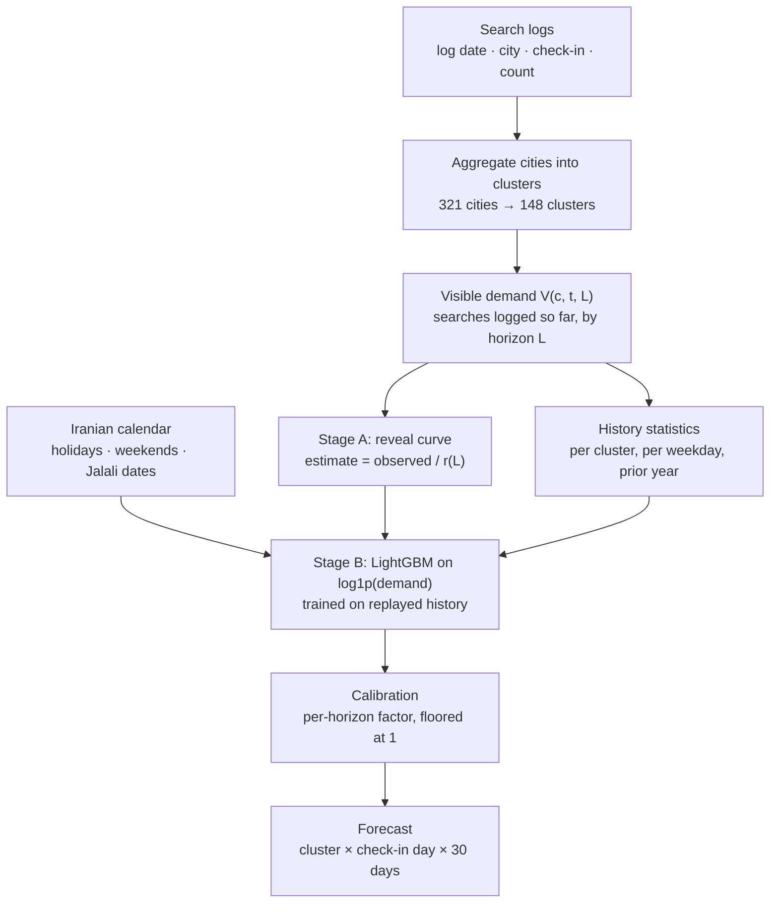

# Methodology

This document explains *why* the model is built the way it is. For the headline results see the
[README](../README.md); for everything that was tried and discarded see
[EXPERIMENTS.md](EXPERIMENTS.md).

- [1. Problem and notation](#1-problem-and-notation)
- [2. System overview](#2-system-overview)
- [3. Stage A - the reveal curve](#3-stage-a---the-reveal-curve)
- [4. Stage B - learning the correction](#4-stage-b---learning-the-correction)
- [5. Calibration](#5-calibration)
- [6. Clustering sparse cities](#6-clustering-sparse-cities)
- [7. Evaluation protocol and leakage control](#7-evaluation-protocol-and-leakage-control)
- [8. Engineering decisions](#8-engineering-decisions)
- [9. What the evidence does and does not establish](#9-what-the-evidence-does-and-does-not-establish)

## 1. Problem and notation

A rental platform logs every search as *(log date, city, intended check-in date)*. For a
(city, check-in) pair the **demand** is the total number of searches ever made for it. The task is
to forecast, on the last day of one month, the demand of **every city for every check-in day of
the next month** (30 days), scored with WAPE.

| symbol | meaning |
|---|---|
| `c`, `t` | cluster (a group of nearby cities) and check-in date |
| `ℓ = t − s` | **lead**: days between a search on log date `s` and the stay `t` (0 … 59) |
| `S(c,t,ℓ)` | searches for `(c,t)` made `ℓ` days ahead |
| `D(c,t) = Σℓ S(c,t,ℓ)` | final demand - the quantity to predict |
| `τ` | forecast origin: the last day whose logs are known |
| `L = t − τ` | forecast horizon (1 … 30 days) |
| `V(c,t,L) = Σℓ≥L S(c,t,ℓ)` | **visible demand**: what has been searched by `τ` |

`V` is non-increasing in `L`, and `V(c,t,0) = D(c,t)`. At the origin we observe
`V(c,t,L)` for each future check-in, and must predict `D(c,t)`.

$$\text{WAPE} = \frac{\sum_{c,t}\lvert \hat D(c,t) - D(c,t)\rvert}{\sum_{c,t} D(c,t)}$$

WAPE is demand-weighted: a few big clusters dominate it, and tiny cities with large *relative*
errors barely matter (on the original data, cells with demand below 10 are ~2.5 % of cells but
~0.006 % of demand).

### Why this is not an ordinary time-series problem

1. **Right-censoring.** A date 30 days out has only ~4-5 % of its eventual searches in the log.
   The most informative input is *partial* by construction, and *how* partial depends on the
   horizon, the weekday and the city.
2. **Two years of history.** Seasonal events (Nowruz, the Shahrivar/Mehr travel peak) have only
   one or two prior occurrences, so any feature that memorises "this week of the year" is fragile.
3. **Heavy-tailed cities.** A handful of clusters carry most of the volume, while hundreds of
   small cities are mostly zeros.
4. **A non-Gregorian calendar.** Demand follows the Persian calendar (Nowruz, Yalda, Jalali
   months) and a Thursday-Friday weekend.

## 2. System overview



The two stages split the job by *what can be known*:

* **Stage A is a physical model.** It encodes the one structural fact of the problem - demand
  is revealed progressively - with a handful of robust statistics. It is accurate where little
  demand is still unseen (short horizons) and noisy where it is amplified ~20× (long horizons).
* **Stage B is a statistical correction.** It learns, from replayed history, when and by how much
  Stage A is biased, using calendar, holiday and cluster-history context.

## 3. Stage A - the reveal curve

Let `r(c,t,L) = V(c,t,L) / D(c,t)` be the fraction of a check-in's final demand already searched
`L` days ahead. If `r` were known, `D̂ = V / r` would be exact. It is estimated from history:

```
r̂(c, w, L) = median over past (c, t) of  V/D        # per cluster, pooled fallback for new clusters
             × weekday_factor(w, L)                  # pooled across clusters, clipped to [0.3, 3]
             clipped below at 0.02                   # never gross up by more than 50×
```

* **Medians**, not means: `V/D` is heavy-tailed because `D` can be tiny.
* **A per-cluster curve** captures that resorts are booked earlier than commuter towns.
* **A pooled weekday factor** captures that *Thursday and Friday check-ins are planned further
  ahead* (the weekend), so a fixed horizon reveals a smaller share of them. It is estimated across
  all clusters because per-cluster-per-weekday medians would be too noisy.

The curve is plotted in the README (`docs/images/reveal_curve.png`). A naive baseline uses only the
pooled curve; Stage A cuts WAPE roughly in half on average over the three regular held-out months
(0.376 → 0.192; per-month reductions of 21-62 %).

**Implementation:** [`reveal_curve.py`](../src/demand_forecasting/reveal_curve.py) - fit and
lookups are vectorised (array indexing instead of a per-lead Python loop), with unit tests that
recover a known curve exactly and prove that future check-ins cannot change the fit.

## 4. Stage B - learning the correction

### 4.1 Replaying history to match the inference regime

At forecast time every row is *partial*. Training on completed history alone would teach the model
a regime it never faces. Instead the training set **replays** every historical `(c,t)` as if
observed at 13 different horizons (`1, 2, 3, 5, 7, 10, 13, 16, 20, 22, 25, 27, 30` days ahead):

| `lead` | `partial_observed` | `stageA_estimate` | `target` |
|---|---|---|---|
| 13 | `V(c,t,13)` | `V / r̂(c,w,13)` | `D(c,t)` *(known in hindsight)* |

On the original data this yields ~1.45 M rows (752 check-in days × 148 clusters × 13 leads). The
rows are correlated (one check-in appears 13 times), which is why validation is split **by check-in
date**, never by row.

### 4.2 Features (20)

| group | features |
|---|---|
| censored signal | `lead`, `partial_observed_log`, `stageA_estimate_log` |
| calendar | `month`, `dow` (Saturday = 0 … Friday = 6), `jalali_month`, `jalali_week`, `week_of_month` |
| holidays | `is_holiday`, `is_weekend`, `is_day_off`, `is_bridge_day`, `in_holiday_block`, `days_to_nearest_holiday`, `nearest_block_length` |
| cluster history | `cluster_hist_mean_log`, `cluster_hist_std_log`, `cluster_dow_hist_mean_log`, `cluster_dow_hist_std_log` |
| last year | `prior_year_demand_log` (same date a year earlier, ±6 days) |

Design notes:

* **Weekday level, not just weekday timing.** Stage A's weekday factor fixes *when* demand is
  revealed; the per-cluster-per-weekday history statistics fix *how much* there is (Wednesday and
  Thursday sit well above Monday and Tuesday). They are different effects and were added separately.
* **Block features.** Holiday *blocks* (runs of consecutive days off, including the Thursday-Friday
  weekend) matter more than single holidays: a 13-day Nowruz is not a one-day observance.
  [`calendar_features.py`](../src/demand_forecasting/calendar_features.py) derives them from a
  plain calendar and a test proves the bundled table is reproduced bit for bit.
* **A removed feature.** The original feature list had a 21st column, `cluster_hist_n`, which is
  constant on a zero-filled grid and was ignored by LightGBM; removing it provably changes nothing
  (verified: identical predictions and identical tree count).

### 4.3 Objective and training

* **Target `log1p(D)` with an L1 loss.** Demand spans five orders of magnitude; the log makes
  errors relative and the L1 loss is robust to the occasional spike.
* **LightGBM**, 63 leaves, learning rate 0.03, `min_data_in_leaf` 30, `feature_fraction` 0.8, up
  to 2,000 rounds with early stopping (patience 100) on the **last 60 days of check-ins** before
  the forecast window (all leads of those days).
* **Deterministic mode** (`deterministic=True`, `force_row_wise=True`): the same inputs reproduce
  the same trees. This turned out to matter: before it was enabled, identical runs differed enough
  to make a per-cell diagnostic unreliable.

## 5. Calibration

An L1 loss on the log scale predicts roughly the conditional **median**, which for a right-skewed
target lies below the conditional **mean** that WAPE rewards. The uncalibrated model therefore
under-predicts almost everywhere.

`Calibration` multiplies predictions by `Σ truth / Σ prediction`, estimated **per forecast-horizon
bucket** ((0,3], (3,7], (7,14], (14,21], (21,30] days) on the validation fold - never on the window
being scored - and **floored at 1.0**.

*Why the floor?* Because median ≤ mean, the true correction is always an up-scaling. A fold
estimate below 1 therefore cannot be a real over-prediction tendency; it is fold noise (a local
seasonal quirk in the last 60 days). Without the floor the correction once pushed a held-out WAPE
from 0.136 to 0.155 (the fold's factor was 0.925 - the wrong sign); with it the same case became a
harmless no-op. An earlier un-floored per-bucket variant had also regressed (experiment #4).

For the production model the factors range from +3 % (last 3 days) to +17 % (22-30 days).

**Honest caveat.** Calibration helped on two backtest months (-0.008 and -0.046 WAPE), was neutral
on one, and **hurt on one** (+0.027): the validation fold sat in a seasonally different regime than
the scored month. It is a bias correction learned from the recent past, so it inherits that past's
quirks. See the results table in the README.

## 6. Clustering sparse cities

The task allows forecasting clusters instead of cities but penalises "excessive aggregation", and
the pooled Stage A statistics and the shared GBM are hurt by hundreds of near-empty series. So
aggregation is **minimal and demand-driven**:

> Start with one cluster per city. Repeatedly take any cluster whose demand is below `floor`
> in **at least one month** of the reference year and merge it into its **geographically nearest
> cluster of the same province** (haversine distance between demand-weighted centroids), until every
> cluster clears the floor in every month - or its province has nothing left to merge with.

Tracking the full monthly demand *vector* (rather than one total) matters: a seasonal town can have
a healthy average and still be empty for a month, which an average threshold would miss.

On the original data a floor of 500 searches/month turns 321 cities into **148 clusters** (80
singletons; the largest cluster has 13 cities). The code reproduces the shipped mapping exactly.

**A subtle coupling.** Re-clustering is *not* a local change. Every cluster-set variant tried
(experiments #25-#29) regressed one backtest month by up to +0.03 WAPE - even when confined to
<2.5 % of volume - because the reveal curve's pooled statistics and the shared training panel
shift, re-calibrating the large clusters that dominate WAPE. A proper fix would fit the pooled
statistics from a fixed reference set of large clusters; it is listed as future work.

**A latent bug, found during the refactor.** The demand-weighted centroid divides by the cluster's
demand, so two *zero-demand* clusters merged to a centroid at (0°, 0°); they were then "nearest" to
whichever cluster lay closest to the Gulf of Guinea (three merges spanned 6,400-7,100 km). 63 of
the 321 cities had no demand in the reference year, so this happened 15 times. The default keeps
this behaviour so the shipped clusters are reproducible; `--fix-zero-volume-centroid` uses the mean
of the coordinates instead. Its measured effect is in [EXPERIMENTS.md](EXPERIMENTS.md#35-zero-volume-centroid-fix).

## 7. Evaluation protocol and leakage control

**Rolling-origin backtests under the production regime.** To score month `M`, the model pretends
it is the last day of `M-1`:

```
 history (fit everything here)            cutoff            window M (30 days ahead)
 ───────────────────────────────────────▶ │ ◀────────────────────────────────────────
  check-ins strictly before M              last logged day   truth = D(c,t) as eventually logged
```

Four months are scored (Azar 1403, Mordad 1404, Shahrivar 1404, Aban 1404). Bahman 1404 onwards
cannot be: the logs end on 2025-11-21, so the target month itself (Azar 1404) has **no ground
truth** in the data.

**No-leakage rule.** Every fitted quantity - reveal curve, per-cluster and per-weekday statistics,
prior-year demand, the training panel, the validation fold - uses check-ins **strictly before
`hist_end`**, the first day of the scored window. This is enforced by a test
(`test_features_do_not_leak_logs_written_after_the_cutoff`): it inflates, for every check-in in
the scored window, all demand logged *after* the cutoff, and asserts that **every feature, every
Stage A estimate and the entire training panel are unchanged**.

**Splits by time, never by row.** The early-stopping/calibration fold is the last 60 days of
check-ins; rows of the same check-in at different leads never straddle the split.

## 8. Engineering decisions

| decision | rationale |
|---|---|
| `src/` package + CLI instead of scripts with hard-coded paths | installable, importable, testable; no `/home/<user>/...` |
| One feature builder for training *and* inference | the original duplicated the merges; a single path removes train/serve skew |
| Artifacts as text / JSON / CSV, **not pickle** | pickle executes code on load; unsafe to publish |
| LightGBM native API | no scikit-learn dependency, no deprecation churn; reproduces the scikit-learn-API results (same iteration counts, predictions equal to ~1e-11) |
| Synthetic data generator | the data cannot be published, so the repo must be runnable and testable without it |
| `pandas` 2.x **and** 3.x supported | CI runs Python 3.10-3.12; FutureWarnings are errors in tests |
| Bit-level regression check against the original code | the refactor reproduces the original clusters, calendar, all four backtests and the final Azar 1404 forecast exactly (see README) |

**Runtime** (8-core laptop, 8 GB RAM): clustering ~6 s; a backtest 15 s - 2 min depending on how
many trees early stopping keeps; all four backtests ~3.5 min; training the production model ~2
min; forecasting ~5 s.

## 9. What the evidence does and does not establish

* **The fitted parameters are cleanly out-of-sample; the modelling decisions are not.** Each
  backtest month is excluded from fitting, but the same few months were used to decide which
  features to keep, whether to calibrate, the guardrail thresholds and the clustering floor. The
  reported WAPE is therefore optimistic relative to a truly untouched test set.
* **Four windows are few.** Differences of a few thousandths of WAPE between variants are within
  run-to-run noise (quantified in EXPERIMENTS.md, experiment #36) and should not drive decisions.
* **One month is a failure case.** Shahrivar (the seasonal travel peak) is forecast *worse* by
  Stage B than by Stage A; see the README for the diagnosis and the mitigations that were tried.
* **No uncertainty estimates.** The model produces point forecasts only.
